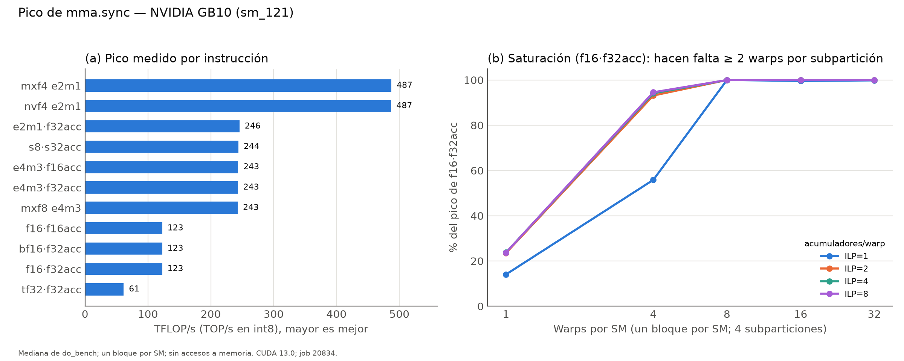
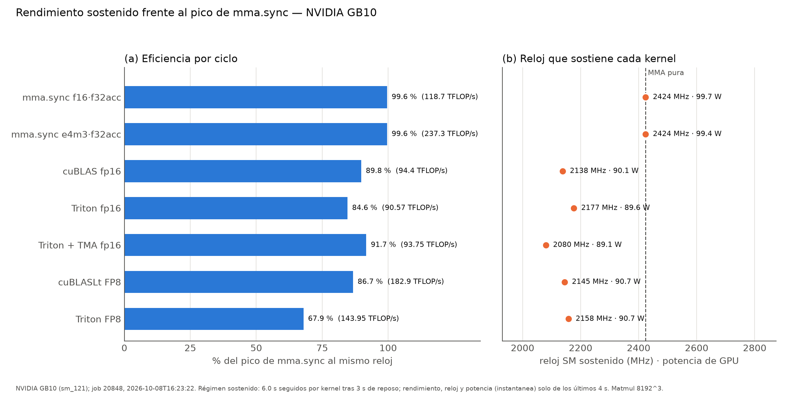

# Pico real de los tensor cores: microbenchmark de `mma.sync`

*Sección consolidada para la memoria del TFM. Datos: `results/hennessy/run_pico_mma/ultimo/` (job 20834). Hardware: NVIDIA GB10 (sm_121, 48 SMs), CUDA 13.0, driver del entorno `hennessy`. Código: `src/Microbench/pico_mma_ext.cu`, `benchmarks/run_pico_mma.py`.*

## Motivación

Todo el TFM se apoya en una afirmación: en Blackwell GeForce (sm_120/sm_121) no hay `wgmma` ni `tcgen05`, y todos los DSLs acaban emitiendo `mma.sync`, así que **el techo lo pone esa instrucción** (§ [tma.md](tma.md), bitácora 2026-10-05). Hasta ahora ese techo no tenía cifra: los kernels se comparaban entre sí y con cuBLAS, pero no con lo que el hardware puede dar realmente. NVIDIA no publica el ritmo de `mma.sync` para sm_121, y las cifras de catálogo mezclan sparsity y precisiones bajas.

Este experimento mide ese techo directamente, instrucción a instrucción. Así cada resultado de los DSLs puede expresarse como **% del pico alcanzable**, en lugar de "% de cuBLAS".

## Método

Un kernel CUDA con PTX en línea (`asm volatile`) en el que cada warp:

1. carga **una sola vez** sus fragmentos A y B en registros, desde un buffer con datos aleatorios del tipo correspondiente (con datos reales, no con ceros, para no falsear la potencia);
2. encadena `iters × ILP` instrucciones `mma.sync` sobre **ILP acumuladores independientes**, sin ningún acceso a memoria;
3. escribe al final un único valor por hilo, para que el compilador no elimine el bucle.

Se lanza **un bloque por SM** y se barre el número de warps por SM (1, 4, 8, 16, 32) y el ILP (1, 2, 4, 8). Cada lanzamiento dura unos 2 ms; la medida es la mediana de `do_bench`, y en paralelo se muestrean el reloj SM y la potencia por NVML. Con el reloj se obtiene **FLOP/ciclo/SM**, la cifra intrínseca de la arquitectura e independiente de la frecuencia.

Antes de medir, cada instrucción se compila sola (`nvcc -cubin`) para `sm_121a`, la variante específica de la arquitectura, que es la que exigen las MMA *block-scaled*. Después se comprueba en el SASS (`cuobjdump`) que se ejecuta como instrucción de tensor core (`HMMA`/`QMMA`/`IMMA`/`OMMA`).

## Resultados

| instrucción PTX | SASS | pico | FLOP/ciclo/SM | relativo a f16 |
|:---|:---|---:|---:|---:|
| `m16n8k8` tf32 → f32 | `HMMA.1688.F32.TF32` | 61.4 TFLOP/s | 511 | 0.5× |
| `m16n8k16` f16 → f32 | `HMMA.16816.F32` | **122.7 TFLOP/s** | 1 014–1 024 | 1× |
| `m16n8k16` f16 → f16 | `HMMA.16816.F16` | 122.8 TFLOP/s | 1 020 | 1× |
| `m16n8k16` bf16 → f32 | `HMMA.16816.F32.BF16` | 122.8 TFLOP/s | 1 019 | 1× |
| `m16n8k32` e4m3 → f32 | `QMMA.16832.F32.E4M3.E4M3` | **243.3 TFLOP/s** | 2 041 | 2× |
| `m16n8k32` e4m3 → f16 | `QMMA.16832.F16.E4M3.E4M3` | 243.5 TFLOP/s | 2 038 | 2× |
| `m16n8k32` s8 → s32 | `IMMA.16832.S8.S8` | 243.9 TOP/s | 2 031 | 2× |
| `kind::f8f6f4` e2m1 (FP4 en 8 bits) | `QMMA.16832.F32.E2M1.E2M1` | 245.7 TFLOP/s | 2 051 | 2× |
| `kind::mxf8f6f4` MXFP8 (ue8m0, 1X) | `QMMA.SF.16832.F32.E4M3.E4M3.E8` | 242.9 TFLOP/s | 2 038 | 2× |
| `kind::mxf4nvf4` MXFP4 (ue8m0, 2X) | `OMMA.SF.16864.F32.E2M1.E2M1.E8` | **487.3 TFLOP/s** | 4 089 | 4× |
| `kind::mxf4nvf4` NVFP4 (ue4m3, 4X) | `OMMA.SF.16864.F32.E2M1.E2M1.UE4M3.4X` | 486.9 TFLOP/s | 4 085 | 4× |

*Cada punto del barrido dura ~0.35 s, así que estos picos son **de ráfaga**, con el reloj SM a 2 480–2 520 MHz. En régimen sostenido (6 s seguidos, job 20848, `run_sostenido`) la MMA pura mantiene **2 424 MHz** con ~100 W y da **118.7 TFLOP/s en f16 y 237.3 en e4m3**: el 99.6 % de 1 024 / 2 048 FLOP/ciclo/SM a ese reloj. Las potencias del job 20834 son el promedio retrasado de NVML y no son fiables (§ "Medir reloj y potencia en GB10"). Tabla completa (barrido warps × ILP): `resultados/hennessy/run_pico_mma.md` y `resultados.csv`.*

## Análisis

1. **La unidad MMA de GB10 hace 1 024 FLOP/ciclo/SM en FP16**: 512 FMA/ciclo/SM o 128 por subpartición. Eso da 122.7 TFLOP/s en ráfaga (48 SMs × 2.5 GHz) y **118.7 sostenidos** (2.42 GHz). La cifra por ciclo es la intrínseca; los TFLOP/s dependen del reloj que se sostenga.

2. **Acumular en FP16 no da nada en GB10.** f16→f16 rinde lo mismo que f16→f32, y lo mismo pasa con e4m3. Esto contrasta con las GeForce anteriores (Ampere/Ada), cuyo segmento limitaba a la mitad la acumulación en FP32. En GB10 no hay ese recorte, así que acumular en FP32 no cuesta rendimiento.

3. **La escalera de precisiones es limpia: TF32 0.5×, FP16/BF16 1×, FP8/INT8 2×, FP4 4×.**
   - FP4 solo da el 4× con la instrucción **block-scaled `mxf4nvf4`** (`OMMA`, k=64, FP4 empaquetado). El FP4 "no escalado" de `kind::f8f6f4` usa contenedores de 8 bits y rinde como FP8 (`QMMA`, k=32).
   - Las MMA block-scaled (MXFP8, MXFP4, NVFP4) **no cuestan nada** respecto a sus equivalentes sin escala: el escalado va integrado en la instrucción (`.SF`).
   - Solo existen en `sm_121a`. Compilando para `sm_121`, ptxas las rechaza (*"Feature '.kind::mxf4nvf4' not supported on .target 'sm_121'"*, job 20833).

4. **Saturar la MMA exige ≥ 8 warps por SM, es decir, ≥ 2 por subpartición.**
   - Con un warp y una cadena dependiente (ILP=1), cada MMA tarda **~28–29 ciclos** (latencia).
   - Aun con ILP alto, un mismo warp no puede lanzar más de una MMA cada **~17 ciclos**, mientras que la unidad acepta una cada 16 ciclos por subpartición.
   - Por eso con 4 warps/SM (uno por subpartición) el techo es el **~94 %** con cualquier ILP, y con ILP=1 el **56 %**.
   - Consecuencia de diseño: los kernels con `num_warps=4` (Triton + TMA en matmul, el tutorial de atención) o `num_warps=2` (Helion atención) necesitan **varios bloques residentes por SM** para no perder rendimiento por emisión.

## Medir reloj y potencia en GB10

Expresar un kernel como "% del pico" exige saber a qué reloj iba, porque el pico es 1 024 FLOP/ciclo/SM × 48 × reloj. Dos sondas (jobs 20844 y 20845; salidas en [resultados/sondas/](resultados/sondas/)) muestran que medirlo bien en GB10 no es trivial:

- **NVML actualiza reloj y potencia cada ~0.5 s.** Una medida de `do_bench` (~0.6 s) obtiene una o dos muestras.
- **La potencia de `nvmlDeviceGetPowerUsage` es un promedio retrasado ~1 s.** Al empezar una carga, la potencia *instantánea* (`NVML_FI_DEV_POWER_INSTANT`) ya marca 100 W y la promedio aún 20 W. En la sonda 20844, cuBLAS a 95 TFLOP/s llegó a leer 10.8 W. Desde el 2026-10-08, `comun.Muestreador` usa la instantánea si el driver la da, y `meta.json` registra la fuente en `potencia_fuente`.
- **El reloj tarda ~0.5 s en bajar.** Con un GEMM continuo pasa de ~2 410 a ~2 180 MHz y se queda ahí (job 20845). Una medida corta cae sobre todo en el transitorio.

Por eso las cifras de reloj y potencia de los jobs 20835–20837 (registradas con `do_bench` y potencia promedio) **no sirven para corregir el pico**. Una lectura anterior basada en ellas ("TMA ahorra un tercio de potencia") era un artefacto. Repetida con la potencia instantánea (job 20847), TMA y block-ptr consumen 88 y 90 W. La medida válida es la de régimen sostenido.

## Los resultados del TFM como % del pico alcanzable

**Régimen sostenido** (`run_sostenido`, job 20848). Cada kernel se ejecuta 6 s seguidos tras 3 s de reposo, y el rendimiento, el reloj y la potencia (instantánea) se calculan solo sobre los últimos 4 s. Matmul 8192³:

| kernel | TFLOP/s | reloj (MHz) | potencia (W) | pico de `mma.sync` a ese reloj | **% del pico al mismo reloj** | % del pico nominal (122.7 / 243.3) |
|:---|---:|---:|---:|---:|---:|---:|
| `mma.sync` f16→f32 (microbenchmark) | 118.7 | 2 424 | 100 | 119.1 | 99.6 % | 97 % |
| `mma.sync` e4m3→f32 (microbenchmark) | 237.3 | 2 424 | 99 | 238.3 | 99.6 % | 98 % |
| cuBLAS fp16 | 94.4 | 2 138 | 90 | 105.1 | **89.8 %** | 77 % |
| Triton fp16 | 90.6 | 2 177 | 90 | 107.0 | 84.6 % | 74 % |
| Triton + TMA fp16 | 93.8 | 2 080 | 89 | 102.2 | **91.7 %** | 76 % |
| cuBLASLt FP8 | 182.9 | 2 145 | 91 | 210.9 | 86.7 % | 75 % |
| Triton FP8 | 144.0 | 2 158 | 91 | 212.1 | 67.9 % | 59 % |

*Una ejecución por kernel. NVML da ~8 muestras de reloj en los 4 s útiles. Tabla generada: `resultados/hennessy/run_sostenido.md`.*

**FlashAttention, GB10** (jobs anteriores, sin reloj; % sobre el pico nominal de 122.7):

| kernel | TFLOP/s | % del pico nominal |
|:---|---:|---:|
| Triton, fp16 | 91.7 | 75 % |
| CUTLASS (CuTe), fp16 / causal | 91.4 / 90.8 | 74 % / 74 % |
| PyTorch SDPA, fp16 | 84.8 | 69 % |
| Helion, fp16 / causal | 66.5 / 42.1 | 54 % / 34 %* |

*\*El causal de Helion no se salta el triángulo superior (bitácora 2026-10-05): hace el doble de trabajo del que se contabiliza.*

Lecturas:

- **Ningún kernel real pasa del ~77 % del pico nominal**, pero ese hueco tiene dos partes de tamaño parecido:
  - **Reloj (~12–15 puntos).** La MMA pura sostiene 2 424 MHz, pero cualquier GEMM real baja a 2 080–2 180 MHz. Lo hace consumiendo *menos* potencia de GPU según NVML (~90 W frente a 100 W). El límite, por tanto, no es la potencia de la GPU tal como la mide NVML. Una hipótesis plausible, pendiente de verificar, es el presupuesto total del chip: GB10 comparte potencia y memoria LPDDR5X con la CPU, y un GEMM mueve datos por L2 y DRAM, cosa que la MMA pura no hace.
  - **Por ciclo (~8–15 puntos en los buenos kernels).** A su propio reloj, cuBLAS y Triton + TMA llegan al 90–92 % y Triton y cuBLASLt FP8 al 85–87 %. Lo que falta se pierde en alimentar `mma.sync` (`ldmatrix`, esperas de `cp.async`/TMA, sincronización, *epilogue*). Para atribuirlo hacen falta contadores de Nsight Compute.
- **TMA mejora la eficiencia por ciclo** (91.7 % frente a 84.6 % del Triton sin TMA), pero ese kernel sostiene un reloj algo más bajo (2 080 frente a 2 177 MHz). El resultado neto es el +3.5 %. Esto matiza [tma.md](tma.md): TMA sí descarga trabajo de la ruta hacia la MMA; lo que limita su ganancia en GB10 es el reloj.
- **En FP8, Triton se queda en el 68 % a su reloj** (cuBLASLt, 87 %). Encaja con [fp8.md](fp8.md): el hueco es de *scheduling* (kernel no persistente), no de reloj.
- **Esto matiza la conclusión de [resumen.md](resumen.md)** ("el baseline está limitado por la MMA"). En GB10, el matmul está limitado a partes parecidas por el reloj que el chip sostiene bajo carga real y por la ruta de datos hacia la MMA, no por el ritmo de la instrucción.
- **FP4 es la palanca que queda.** 487 TFLOP/s en ráfaga es el doble que FP8, y ningún kernel del TFM usa todavía `mxf4nvf4`. Triton lo expone con `tl.dot_scaled`, y CUTLASS con el ejemplo `blockscaled_gemm` de Blackwell GeForce.

## Conclusión

La unidad MMA de GB10 hace **1 024 FLOP/ciclo/SM en FP16/BF16, 2 048 en FP8/INT8 y 4 096 en MXFP4/NVFP4**, sin penalización por acumular en FP32 ni por el escalado por bloques. A ~2.5 GHz en ráfaga son 122.7 / 243 / 487 TFLOP/s; la MMA pura sostiene 2.42 GHz (118.7 TFLOP/s en FP16). Para saturarla hacen falta al menos dos warps por subpartición.

Los mejores kernels del TFM (cuBLAS, cuBLASLt FP8, Triton + TMA) sostienen el **75–77 % del pico nominal**. Aproximadamente la mitad del hueco es reloj: un GEMM real hace bajar GB10 a ~2.1–2.2 GHz aunque la potencia de GPU que da NVML sea menor que con la MMA pura. La otra mitad se pierde por ciclo, alimentando la MMA. A su propio reloj, estos kernels rinden el 87–92 % del pico.

**Líneas abiertas:**
1. Atribuir la bajada de reloj: potencia del módulo completo (CPU + GPU + memoria), *throttle reasons* de NVML (`nvmlDeviceGetCurrentClocksEventReasons`), y prueba con el reloj fijado si el driver lo permite.
2. Contadores de Nsight Compute en el matmul para atribuir la pérdida por ciclo.
3. Medir los benchmarks de DSLs en régimen sostenido, no solo con `do_bench`, cuando se comparen kernels de duración muy distinta.
4. Comparar con la RTX 5090 (pascal; jobs 20838–20840 en cola).
5. Un matmul MXFP4/NVFP4 (`tl.dot_scaled`) frente al pico de 487 TFLOP/s.

**Reproducir:** `bash ~/hennessy/tfm_entorno/ejecutar.sh encolar exp run_pico_mma` (≈ 2 min) y `... encolar exp run_sostenido` (≈ 3 min). Para regenerar solo la tabla y la gráfica del pico, sin GPU: `python3.11 benchmarks/run_pico_mma.py --informe results/hennessy/run_pico_mma/ultimo`.
