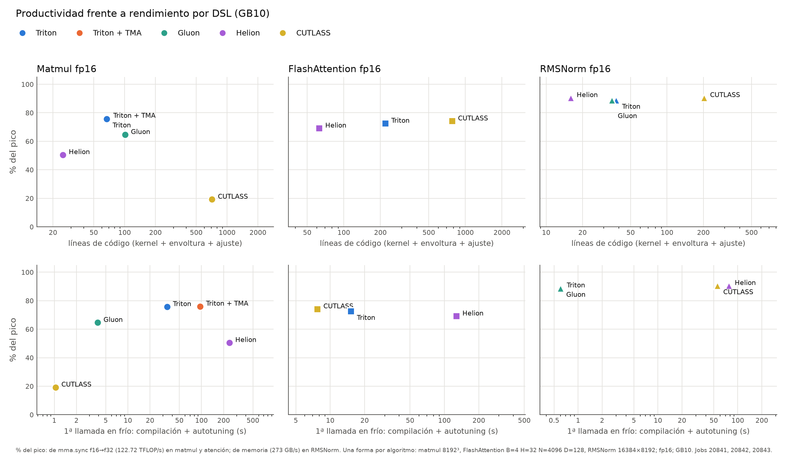

# Productividad frente a rendimiento de cada DSL

*Sección consolidada para la memoria del TFM. Datos: `results/hennessy-frio/` (jobs 20841–20843, caché de compilación vacía) y análisis estático del código (`benchmarks/productividad.py`). Hardware: NVIDIA GB10 (sm_121). Tabla generada: `resultados/productividad.md` y `results/productividad.csv`.*

## Motivación

El resumen por arquitectura compara los DSLs solo por rendimiento. Pero lo que distingue a Triton, Gluon, Helion y CUTLASS es el compromiso entre **cuánto hay que escribir y ajustar** y **cuánto rinde** lo escrito. Helion promete kernels de pocas líneas y autotuning automático; CUTLASS/CuTe, control total a cambio de mucho código; Gluon, el control de layouts de Triton sin su autotuner. Esta sección mide ese compromiso con tres indicadores reproducibles:

1. **Líneas de código** que implementan el algoritmo.
2. **Coste del ajuste**: modo de ajuste, tamaño del espacio de configuraciones y tiempo de la primera llamada con la caché vacía.
3. **Rendimiento** de esa misma ejecución, como % del pico del hardware.

## Método

**Líneas de código lógicas (LoC):** líneas con código, sin blancos, comentarios ni docstrings (`tokenize` + `ast` en Python; eliminación de comentarios en C++). Se separan tres partes:
- **kernel**: el código del algoritmo, con su lanzador y su espacio de configuraciones. Si el repo carga un **ejemplo oficial de fuera** (los de CUTLASS desde `/opt/cutlass` o el de atención de Helion), se cuenta *ese* código, descargado en la versión fijada del TFM (CUTLASS v4.8.0, Helion `0f3b242`), y solo la parte del algoritmo: la clase del kernel o la función `@helion.kernel`, sin `run()`, tests ni `main`. En el FlashAttention de Triton, copia literal del tutorial, solo se cuenta el *forward*.
- **envoltura**: código propio para cargar o adaptar un kernel externo.
- **ajuste**: código propio para elegir la configuración cuando el DSL no trae autotuning (el barrido de Gluon en matmul y el de CuTe en atención).

Cuando se cuenta un fichero entero del repo, los `import` cuentan; en las selecciones de código externo, no. La diferencia es de unas pocas líneas.

**Coste del ajuste:** tiempo de la **primera llamada** (compilación JIT + autotuning o barrido + primera ejecución) con **todas las cachés vacías**. El modo `TFM_CACHE_FRIA=1` de `ejecutar.sh` lleva la caché de Triton y la de extensiones al `/tmp` del contenedor efímero. Las de Inductor, Helion y CuTe ya vivían en `/tmp`. Antes de esto, `TRITON_CACHE_DIR` era persistente, y por eso el job 20682 midió el FlashAttention de Triton completo en 17 s: los tiempos guardados mezclaban compilaciones en frío y en caliente. El tamaño del espacio sale del código para Triton, Gluon y CuTe, y del log de Helion (*"after searching N configs"*).

**Forma:** una por algoritmo, la misma para todos los DSLs, en fp16: matmul 8192³, FlashAttention B=4 H=32 N=4096 D=128 sin máscara causal, RMSNorm 16384×8192. Las ejecuciones en frío van al entorno `hennessy-frio`, que el resumen de rendimiento ignora.

**% del pico:** en matmul y atención, frente al pico nominal de `mma.sync` f16→f32 (122.7 TFLOP/s, § [pico_mma.md](pico_mma.md)); en RMSNorm, frente al ancho de banda teórico (273 GB/s).

## Resultados



| algoritmo | DSL | LoC kernel | LoC propias | LoC total | ajuste | configs | 1ª llamada en frío | rendimiento | % del pico |
|:---|:---|---:|---:|---:|:---|---:|---:|---:|---:|
| Matmul | Triton | 67 | 67 | 67 | autotune | 64 | 34.1 s | 93.0 TFLOP/s | 76 % |
| Matmul | Triton + TMA | 68 | 68 | 68 | autotune | 128 | 96.1 s | 93.3 TFLOP/s | 76 % |
| Matmul | Gluon | 85 | 101 | 101 | barrido propio | 7 | 3.9 s | 79.3 TFLOP/s | 65 % |
| Matmul | Helion | 25 | 25 | 25 | autotune (quick) | 251 | 4.0 min | 61.9 TFLOP/s | 50 % |
| Matmul | CUTLASS (CuTe) | 672 | 41 | 713 | fija | 1 | 1.0 s | 23.6 TFLOP/s | 19 % |
| FlashAttention | Triton | 220 | 220 | 220 | autotune | 36 | 15.2 s | 89.0 TFLOP/s | 72 % |
| FlashAttention | Helion | 45 | 18 | 63 | autotune (quick) | 135 | 2.1 min | 84.8 TFLOP/s | 69 % |
| FlashAttention | CUTLASS (CuTe) | 713 | 65 | 778 | barrido propio | 6 | 7.7 s | 90.9 TFLOP/s | 74 % |
| RMSNorm | Triton | 38 | 38 | 38 | heurística | 1 | 0.6 s | 242.3 GB/s | 89 % |
| RMSNorm | Gluon | 35 | 35 | 35 | heurística | 1 | 0.6 s | 242.1 GB/s | 89 % |
| RMSNorm | Helion | 16 | 16 | 16 | autotune (quick) | 134 | 77.3 s | 247.2 GB/s | 90 % |
| RMSNorm | CUTLASS | 135 | 68 | 203 | fija | 1 | 55.5 s | 247.0 GB/s | 90 % |
| RMSNorm | Triton + TLX | 52 | 52 | 52 | heurística + `--stages` | 1 | — | no compila en GB10 | — |

*"LoC propias" = las escritas en el TFM (kernel propio + envoltura + ajuste); el resto es código oficial reutilizado. En CUTLASS RMSNorm, los 55.5 s son la compilación con nvcc de la extensión de PyTorch.*

## Análisis

1. **Helion es, con diferencia, el más conciso**: 16–45 líneas por algoritmo, de 2 a 4 veces menos que Triton y hasta 40 veces menos que CuTe. Pero lo paga en **tiempo de ajuste**: busca 134–251 configuraciones y tarda de 1.3 a 4 minutos por forma, y de 24 a 31 minutos en la atención con N=16384 (bitácora 2026-10-05). El resultado es desigual: iguala o supera al resto en RMSNorm (90 %), se queda cerca en atención (69 % frente a 72–74 %) y queda claramente por detrás en matmul (50 % frente a 76 %). Su autotuning en modo `quick` no encuentra en matmul una configuración comparable a las 64 que Triton prueba en 34 s.

2. **Triton es el punto de equilibrio.** Con 38–220 líneas y autotuning integrado de 15 a 96 s, da el mejor o casi el mejor rendimiento en los tres algoritmos. El coste de ajuste crece con el espacio que se declara: 64 configuraciones en 34 s y 128 en 96 s (TMA, por las etapas extra), con la misma ganancia final.

3. **CUTLASS/CuTe exige un orden de magnitud más de código**: 670–710 líneas el kernel oficial, más 40–65 de envoltura y ajuste propios. A cambio, en atención es el más rápido (74 %) con un ajuste barato (6 candidatas en 7.7 s), y su RMSNorm iguala al mejor. **Pero en matmul, el ejemplo oficial para Blackwell GeForce (`dense_gemm`, `Sm120GemmKernel`) rinde solo el 19 % en GB10**, cuando en la RTX 5090 da 165.8 TFLOP/s, el 99 % del cuBLAS medido en ese mismo job (20638); en GB10 se queda en el 24 % de cuBLAS. No es por el número de clusters persistentes: forzando 48, 96 o 192 sigue igual (sonda job 20844, [salida](resultados/sondas/sonda_cute_clusters-20844.txt)). Barriendo el tile CTA, el mejor llega a 37.8 TFLOP/s (128×256×64, sonda job 20846, [salida](resultados/sondas/sonda_cute_tiles-20846.txt)), todavía el 31 %. Queda como problema abierto de portabilidad entre sm_120 y sm_121 del propio ejemplo: el ejemplo trae una sola configuración fija, y nada avisa de que en otra GPU de la misma familia rinde 4 veces menos.

4. **Gluon cuesta más que Triton y rinde menos** en matmul: 101 líneas (85 de kernel + 16 de barrido) frente a 67, y el 65 % frente al 76 %. Sin autotuner, el espacio que se explora a mano es pequeño (7 configuraciones), y eso se nota. En RMSNorm, donde basta una heurística, es equivalente a Triton (35 frente a 38 líneas, mismo rendimiento).

5. **En un operador *memory-bound* como RMSNorm, el DSL apenas importa para el rendimiento**: todos están en el 89–90 % del ancho de banda. Lo que cambia es el coste, desde 16 líneas y 77 s de autotuning (Helion) hasta 203 líneas y 55 s de nvcc (CUTLASS).

6. **El tiempo de ajuste es una dimensión propia, no un detalle.** Va de 0.6 s a 4 min por forma en frío (y hasta 31 min en atención grande), con rendimientos parecidos. En un uso real con muchas formas distintas, como la inferencia de LLMs con longitudes variables, ese coste se multiplica por el número de formas, salvo que se fije la configuración.

## Conclusión

No hay un DSL dominante. **Triton** ofrece el mejor compromiso: código corto, autotuning de segundos y el mejor rendimiento o casi en los tres algoritmos. **Helion** minimiza el código (2–4 veces menos), pero traslada el esfuerzo al autotuning (minutos por forma) y en matmul no alcanza a Triton. **CUTLASS/CuTe** maximiza el control, pero exige un orden de magnitud más de código, y su ejemplo de matmul para Blackwell GeForce no es portable de sm_120 a sm_121 sin reajustarlo. **Gluon** solo compensa cuando hace falta controlar el layout, porque sin autotuner rinde menos que Triton en matmul.

**Limitaciones:**
- Las LoC miden el tamaño del código, no el esfuerzo de escribirlo: una línea de CuTe (layouts, atoms) no cuesta lo mismo que una de Helion.
- El rendimiento es de una ejecución con `do_bench` (régimen de ráfaga; § [pico_mma.md](pico_mma.md)).
- Los tiempos en frío corresponden a una sola forma por algoritmo.

**Reproducir:**
```bash
export TFM_CACHE_FRIA=1 TFM_MAQUINA=hennessy-frio
bash ~/hennessy/tfm_entorno/ejecutar.sh encolar exp matmul --sizes 8192
bash ~/hennessy/tfm_entorno/ejecutar.sh encolar exp attention --seqlens 4096 --head-dims 128 --causal no
bash ~/hennessy/tfm_entorno/ejecutar.sh encolar exp rmsnorm --rows 16384 --cols 8192 --dtypes fp16
python3.11 benchmarks/productividad.py   # sin GPU: LoC, tabla y gráfica
```
