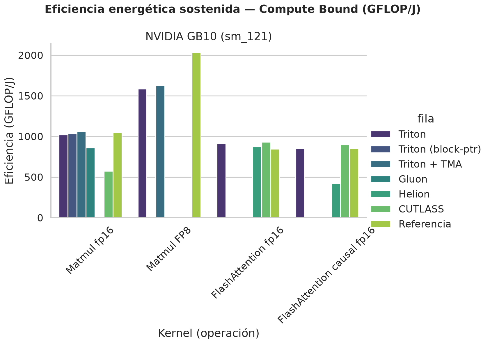
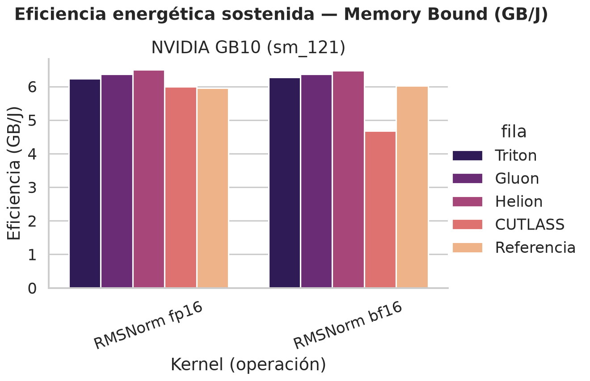

# Eficiencia energética por arquitectura

*Generado por `benchmarks/energia.py` a partir de las ejecuciones con `TFM_ENERGIA=1`. CB en GFLOP/J, MB en GB/J; «×» = eficiencia relativa a la referencia de la misma GPU; «dinámica» descuenta la potencia en reposo.*

## Cómo se calcula

La energía no se mide con un contador de julios: se mide la **potencia** de la GPU mientras el
kernel se ejecuta sin parar y se combina con el trabajo hecho en ese tiempo (`comun.energia()`,
activado con `TFM_ENERGIA=1`).

1. **Potencia en reposo**, una vez por script: 4 s sin carga y mediana de los 2 últimos
   (`potencia_reposo_w`).
2. **Régimen sostenido** de cada kernel, después de su medida con `do_bench`: 3 s de reposo
   (todos parten del mismo estado térmico) y 6 s en bucle, en lotes de ~50 ms seguidos de una
   sincronización. Los 2 primeros segundos se descartan, porque el reloj tarda ~0.5 s en
   estabilizarse bajo carga y NVML en reflejarlo. Cuenta el tramo final de 4 s: llamadas
   completadas / 4 s = **ritmo** (llamadas/s). Duraciones configurables con
   `TFM_ENERGIA_SEGUNDOS` y `TFM_ENERGIA_DESCARTE`.
3. **Potencia y reloj**: un hilo lee de NVML cada 20 ms el reloj SM y la potencia
   **instantánea** de la GPU (`NVML_FI_DEV_POWER_INSTANT`; la de `nvmlDeviceGetPowerUsage` es un
   promedio retrasado ~1 s). Se toma la mediana de las muestras del tramo medido.
4. **Cálculo**:

| magnitud | fórmula |
|:---|:---|
| rendimiento sostenido | ritmo × FLOP por llamada (TFLOP/s) o × bytes por llamada (GB/s) |
| energía por llamada | potencia / ritmo (mJ) |
| eficiencia CB | TFLOP/s sostenidos × 1000 / W = **GFLOP/J** (1 W = 1 J/s) |
| eficiencia MB | GB/s sostenidos / W = **GB/J** |
| eficiencia dinámica | igual, dividiendo por (potencia − potencia en reposo) |
| × referencia | eficiencia del DSL / eficiencia de cuBLAS, SDPA o `F.rms_norm` en la misma GPU y forma |

**Limitaciones.** Es solo la potencia de la GPU según NVML: no incluye CPU, memoria ni el resto
del sistema, así que no es comparable con el TDP de 140 W de todo el SoC de GB10. NVML actualiza
cada ~0.5 s, así que el tramo de 4 s tiene unas 8 lecturas distintas. La potencia en reposo se
mide justo después del autotuning y varía entre scripts (12–17 W en GB10): la eficiencia total es
fiable, y la dinámica depende de esa cifra. Cada kernel se mide una sola vez, sin repeticiones.

## Gráficas

## NVIDIA GB10 (sm_121)

| DSL | Matmul fp16 (CB) | Matmul FP8 (CB) | FlashAttention fp16 (CB) | FlashAttention causal fp16 (CB) | RMSNorm fp16 (MB) | RMSNorm bf16 (MB) |
|:---|:---|:---|:---|:---|:---|:---|
| **Triton** | **1019.6 GFLOP/J (×0.97 ref.)** 88.4 W (reposo 16.9 W) · 1260.6 GFLOP/J dinámica · 90.13 TFLOP/s sost. · 2158 MHz · 1078 mJ/llamada · 8192×8192×8192 _hennessy-energia, job 20849_ | **1585.8 GFLOP/J (×0.78 ref.)** 90.1 W (reposo 16.1 W) · 1930.8 GFLOP/J dinámica · 142.88 TFLOP/s sost. · 2138 MHz · 693.4 mJ/llamada · 8192×8192×8192 _hennessy-energia, job 20849_ | **913.6 GFLOP/J (×1.08 ref.)** 94.7 W (reposo 16.6 W) · 1107.8 GFLOP/J dinámica · 86.52 TFLOP/s sost. · 2171 MHz · 1204 mJ/llamada · B=4 H=32 N=4096 D=128 _hennessy-energia, job 20850_ | **853.6 GFLOP/J (×1 ref.)** 92.2 W (reposo 16.6 W) · 1041 GFLOP/J dinámica · 78.7 TFLOP/s sost. · 2203 MHz · 644.1 mJ/llamada · B=4 H=32 N=4096 D=128 _hennessy-energia, job 20850_ | **6.23 GB/J (×1.05 ref.)** 39.2 W (reposo 14.9 W) · 10.04 GB/J dinámica · 244 GB/s sost. · 2502 MHz · 86.24 mJ/llamada · 16384×8192 _hennessy-energia, job 20851_ | **6.27 GB/J (×1.04 ref.)** 38.9 W (reposo 14.9 W) · 10.16 GB/J dinámica · 243.9 GB/s sost. · 2483 MHz · 85.61 mJ/llamada · 16384×8192 _hennessy-energia, job 20851_ |
| **Triton (block-ptr)** | **1036 GFLOP/J (×0.99 ref.)** 87.9 W (reposo 17 W) · 1284.4 GFLOP/J dinámica · 91.07 TFLOP/s sost. · 2125 MHz · 1061 mJ/llamada · 8192×8192×8192 _hennessy-energia, job 20849_ | — | — | — | — | — |
| **Triton + TMA** | **1064.1 GFLOP/J (×1.01 ref.)** 88 W (reposo 17 W) · 1318.8 GFLOP/J dinámica · 93.64 TFLOP/s sost. · 2047 MHz · 1033 mJ/llamada · 8192×8192×8192 _hennessy-energia, job 20849_ | **1629.2 GFLOP/J (×0.8 ref.)** 90.4 W (reposo 16.1 W) · 1982.2 GFLOP/J dinámica · 147.28 TFLOP/s sost. · 2158 MHz · 674.9 mJ/llamada · 8192×8192×8192 _hennessy-energia, job 20849_ | — | — | — | — |
| **Gluon** | **860.6 GFLOP/J (×0.82 ref.)** 88.3 W (reposo 12.7 W) · 1005.1 GFLOP/J dinámica · 75.99 TFLOP/s sost. · 2158 MHz · 1278 mJ/llamada · 8192×8192×8192 _hennessy-energia, job 20849_ | — | — | — | **6.37 GB/J (×1.07 ref.)** 38.3 W (reposo 14.3 W) · 10.16 GB/J dinámica · 243.9 GB/s sost. · 2502 MHz · 84.32 mJ/llamada · 16384×8192 _hennessy-energia, job 20851_ | **6.37 GB/J (×1.06 ref.)** 38.3 W (reposo 14.3 W) · 10.16 GB/J dinámica · 243.9 GB/s sost. · 2502 MHz · 84.32 mJ/llamada · 16384×8192 _hennessy-energia, job 20851_ |
| **Helion** | — | — | **875.2 GFLOP/J (×1.03 ref.)** 94.7 W (reposo 16.1 W) · 1054.5 GFLOP/J dinámica · 82.88 TFLOP/s sost. · 2132 MHz · 1256 mJ/llamada · B=4 H=32 N=4096 D=128 _hennessy-energia, job 20850_ | **425.2 GFLOP/J (×0.5 ref.)** 94 W (reposo 16.1 W) · 513.1 GFLOP/J dinámica · 39.97 TFLOP/s sost. · 2164 MHz · 1293 mJ/llamada · B=4 H=32 N=4096 D=128 _hennessy-energia, job 20850_ | **6.5 GB/J (×1.09 ref.)** 38.3 W (reposo 15.8 W) · 11.07 GB/J dinámica · 249 GB/s sost. · 2483 MHz · 82.59 mJ/llamada · 16384×8192 _hennessy-energia, job 20851_ | **6.47 GB/J (×1.07 ref.)** 38.5 W (reposo 15.8 W) · 10.97 GB/J dinámica · 249.1 GB/s sost. · 2483 MHz · 82.99 mJ/llamada · 16384×8192 _hennessy-energia, job 20851_ |
| **CUTLASS** | **573.2 GFLOP/J (×0.55 ref.)** 42.7 W (reposo 11.9 W) · 794.6 GFLOP/J dinámica · 24.47 TFLOP/s sost. · 2427.5 MHz · 1918 mJ/llamada · 8192×8192×8192 _hennessy-energia, job 20849_ | — | **930.3 GFLOP/J (×1.1 ref.)** 94.3 W (reposo 14.7 W) · 1102.1 GFLOP/J dinámica · 87.73 TFLOP/s sost. · 2125 MHz · 1182 mJ/llamada · B=4 H=32 N=4096 D=128 _hennessy-energia, job 20850_ | **899.8 GFLOP/J (×1.06 ref.)** 92.1 W (reposo 14.7 W) · 1070.7 GFLOP/J dinámica · 82.87 TFLOP/s sost. · 2119 MHz · 611 mJ/llamada · B=4 H=32 N=4096 D=128 _hennessy-energia, job 20850_ | **6 GB/J (×1.01 ref.)** 41.4 W (reposo 13.7 W) · 8.97 GB/J dinámica · 248.6 GB/s sost. · 2502 MHz · 89.41 mJ/llamada · 16384×8192 _hennessy-energia, job 20851_ | **4.68 GB/J (×0.78 ref.)** 49 W (reposo 13.7 W) · 6.5 GB/J dinámica · 229.3 GB/s sost. · 2502 MHz · 114.7 mJ/llamada · 16384×8192 _hennessy-energia, job 20851_ |
| **Referencia** | **1051.1 GFLOP/J** 87.6 W (reposo 16.9 W) · 1302.4 GFLOP/J dinámica · 92.08 TFLOP/s sost. · 2086 MHz · 1046 mJ/llamada · 8192×8192×8192 _hennessy-energia, job 20849_ | **2036.5 GFLOP/J** 89.5 W (reposo 16.1 W) · 2483.2 GFLOP/J dinámica · 182.27 TFLOP/s sost. · 2112 MHz · 539.9 mJ/llamada · 8192×8192×8192 _hennessy-energia, job 20849_ | **846.6 GFLOP/J** 94.6 W (reposo 16.6 W) · 1026.8 GFLOP/J dinámica · 80.09 TFLOP/s sost. · 2216 MHz · 1299 mJ/llamada · B=4 H=32 N=4096 D=128 _hennessy-energia, job 20850_ | **851 GFLOP/J** 92.7 W (reposo 16.6 W) · 1036.6 GFLOP/J dinámica · 78.88 TFLOP/s sost. · 2216 MHz · 646 mJ/llamada · B=4 H=32 N=4096 D=128 _hennessy-energia, job 20850_ | **5.95 GB/J** 36.5 W (reposo 14.9 W) · 10.06 GB/J dinámica · 217.2 GB/s sost. · 2437 MHz · 90.23 mJ/llamada · 16384×8192 _hennessy-energia, job 20851_ | **6.02 GB/J** 36.2 W (reposo 14.9 W) · 10.23 GB/J dinámica · 217.8 GB/s sost. · 2431 MHz · 89.22 mJ/llamada · 16384×8192 _hennessy-energia, job 20851_ |

