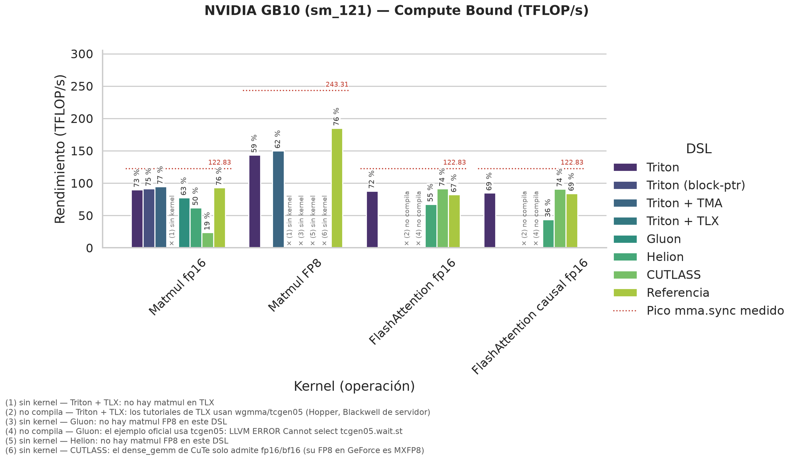
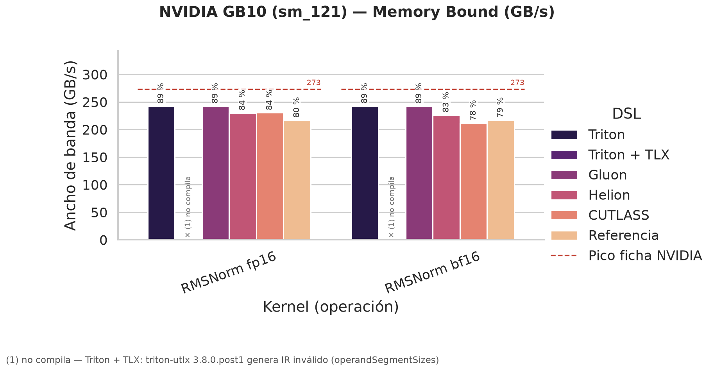

# Resumen: NVIDIA GB10 (sm_121)

*Generado por `benchmarks/resumen.py` a partir de la última ejecución de cada benchmark en cada entorno. CB = compute-bound (TFLOP/s); MB = memory-bound (GB/s y % del pico de memoria). Cada celda: rendimiento en el mayor tamaño medido · % del pico · tamaño · configuración aplicada · entorno y job. Una celda sin dato dice por qué falta.*

*% del pico: en compute-bound, sobre el pico de `mma.sync` medido en esa GPU con `run_pico_mma` (acumulación FP32; en GB10, 122.7 TFLOP/s fp16 y 243.3 FP8, en ráfaga a ~2.5 GHz) o, si no se ha medido, sobre la ficha de NVIDIA (RTX 5090: 209.5 fp16 y 419 FP8 con acumulación FP32, al boost de 2 407 MHz). Por encima del 100 % de la ficha, la GPU va más rápida que el boost o no aplica el recorte de la acumulación FP32 (pendiente: `run_pico_mma` en pascal). En memory-bound, sobre el ancho de banda de la ficha. n/a = la variante no existe para ese algoritmo.*

| DSL | Matmul fp16 (CB) | Matmul FP8 (CB) | FlashAttention fp16 (CB) | FlashAttention causal fp16 (CB) | RMSNorm fp16 (MB) | RMSNorm bf16 (MB) |
|:---|:---|:---|:---|:---|:---|:---|
| **Triton** | **89.89 TFLOP/s** · **73 %** del pico mma.sync medido 8192×8192×8192 · BM=256 BN=128 BK=64 GROUP_M=8 · 8 warps (256 hilos) · 3 etapas _hennessy, job 21058_ | **143.4 TFLOP/s** · **59 %** del pico mma.sync medido 8192×8192×8192 · BM=256 BN=128 BK=128 GROUP_M=8 · 8 warps (256 hilos) · 3 etapas · error 3.75% _hennessy, job 21058_ | **87.96 TFLOP/s** · **72 %** del pico mma.sync medido B=4 H=32 N=16384 D=128 · BM=128 · BN=32 · 2 etapas · 4 warps (128 hilos) _hennessy, job 21058_ | **84.81 TFLOP/s** · **69 %** del pico mma.sync medido B=4 H=32 N=16384 D=128 · BM=128 · BN=32 · 2 etapas · 4 warps (128 hilos) _hennessy, job 21058_ | **242.7 GB/s** · **89 %** del pico de memoria 16384×8192 · 16 warps (512 hilos) _hennessy, job 21058_ | **242.8 GB/s** · **89 %** del pico de memoria 16384×8192 · 16 warps (512 hilos) _hennessy, job 21058_ |
| **Triton (block-ptr)** | **91.71 TFLOP/s** · **75 %** del pico mma.sync medido 8192×8192×8192 · BM=128 BN=256 BK=64 GROUP_M=8 · 8 warps (256 hilos) · 3 etapas · carga=cp.async _hennessy, job 21058_ | n/a | n/a | n/a | n/a | n/a |
| **Triton + TMA** | **94.62 TFLOP/s** · **77 %** del pico mma.sync medido 8192×8192×8192 · BM=128 BN=128 BK=32 GROUP_M=8 · 4 warps (128 hilos) · 4 etapas · carga=TMA _hennessy, job 21058_ | **150.05 TFLOP/s** · **62 %** del pico mma.sync medido 8192×8192×8192 · BM=128 BN=256 BK=128 GROUP_M=8 · 8 warps (256 hilos) · 3 etapas · carga=TMA · error 3.75% _hennessy, job 21058_ | n/a | n/a | n/a | n/a |
| **Triton + TLX** | — *sin kernel*: no hay matmul en TLX | — *sin kernel*: no hay matmul en TLX | — *no compila*: los tutoriales de TLX usan wgmma/tcgen05 (Hopper, Blackwell de servidor) | — *no compila*: los tutoriales de TLX usan wgmma/tcgen05 (Hopper, Blackwell de servidor) | — *no compila*: triton-utlx 3.8.0.post1 genera IR inválido (operandSegmentSizes) | — *no compila*: triton-utlx 3.8.0.post1 genera IR inválido (operandSegmentSizes) |
| **Gluon** | **77.45 TFLOP/s** · **63 %** del pico mma.sync medido 8192×8192×8192 · BM=128 · BN=128 · BK=32 · 3 etapas · 4 warps 2x2 (128 hilos) _hennessy, job 21058_ | — *sin kernel*: no hay matmul FP8 en este DSL | — *no compila*: el ejemplo oficial usa tcgen05: LLVM ERROR Cannot select tcgen05.wait.st | — *no compila*: el ejemplo oficial usa tcgen05: LLVM ERROR Cannot select tcgen05.wait.st | **242.8 GB/s** · **89 %** del pico de memoria 16384×8192 · 16 warps (512 hilos) · 8 elem/hilo (16 B) _hennessy, job 21058_ | **242.8 GB/s** · **89 %** del pico de memoria 16384×8192 · 16 warps (512 hilos) · 8 elem/hilo (16 B) _hennessy, job 21058_ |
| **Helion** | **61.94 TFLOP/s** · **50 %** del pico mma.sync medido (solo medido con caché fría) 8192×8192×8192 · 16 warps (512 hilos) · bloques=[64,512,64] · 2 etapas · autotune=quick _hennessy-frio, job 20841_ | — *sin kernel*: no hay matmul FP8 en este DSL | **67.48 TFLOP/s** · **55 %** del pico mma.sync medido B=4 H=32 N=16384 D=128 · 2 warps (64 hilos) · bloques=[1,64,32] · 1 etapas · autotune=quick _hennessy, job 21058_ | **43.9 TFLOP/s** · **36 %** del pico mma.sync medido B=4 H=32 N=16384 D=128 · 8 warps (256 hilos) · bloques=[1,256,32] · 2 etapas · autotune=quick _hennessy, job 21058_ | **230.3 GB/s** · **84 %** del pico de memoria 16384×8192 · autotune=quick _patterson, job 20435_ | **226.6 GB/s** · **83 %** del pico de memoria 16384×8192 · autotune=quick _patterson, job 20435_ |
| **CUTLASS** | **23.59 TFLOP/s** · **19 %** del pico mma.sync medido (solo medido con caché fría) 8192×8192×8192 · CuTe DSL Sm120GemmKernel · tile 128x128x64 _hennessy-frio, job 20841_ | — *sin kernel*: el dense_gemm de CuTe solo admite fp16/bf16 (su FP8 en GeForce es MXFP8) | **91.39 TFLOP/s** · **74 %** del pico mma.sync medido B=4 H=32 N=16384 D=128 · CuTe DSL FlashAttentionForwardAmpere · BM=128 BN=128 · 256 hilos (8 warps) _hennessy, job 20649_ | **90.8 TFLOP/s** · **74 %** del pico mma.sync medido B=4 H=32 N=16384 D=128 · CuTe DSL FlashAttentionForwardAmpere · BM=128 BN=128 · 256 hilos (8 warps) _hennessy, job 20649_ | **230.5 GB/s** · **84 %** del pico de memoria 16384×8192 · cutlass::rmsnorm _e8 (float4) · 1024 hilos/bloque · 1 bloque/fila _patterson, job 20435_ | **211.6 GB/s** · **78 %** del pico de memoria 16384×8192 · cutlass::rmsnorm _e1 (escalar) · 256 hilos/bloque · 1 bloque/fila _patterson, job 20435_ |
| **Referencia** | **92.96 TFLOP/s** · **76 %** del pico mma.sync medido 8192×8192×8192 · cuBLAS nvjet_sm121_hsh_mma_128x208x64_2_32x104x64_tmaAB_bz_NNNN _hennessy, job 21058_ | **184.97 TFLOP/s** · **76 %** del pico mma.sync medido 8192×8192×8192 · cuBLASLt (torch._scaled_mm) · error 3.75% _hennessy, job 21058_ | **82.19 TFLOP/s** · **67 %** del pico mma.sync medido B=4 H=32 N=16384 D=128 · PyTorch SDPA pytorch_flash::flash_fwd_kernel _hennessy, job 21058_ | **84.21 TFLOP/s** · **69 %** del pico mma.sync medido B=4 H=32 N=16384 D=128 · PyTorch SDPA pytorch_flash::flash_fwd_kernel _hennessy, job 21058_ | **217.1 GB/s** · **80 %** del pico de memoria 16384×8192 · PyTorch F.rms_norm _hennessy, job 21058_ | **216.8 GB/s** · **79 %** del pico de memoria 16384×8192 · PyTorch F.rms_norm _hennessy, job 21058_ |

