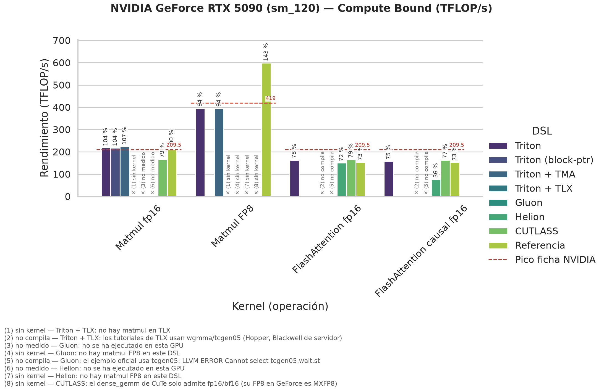
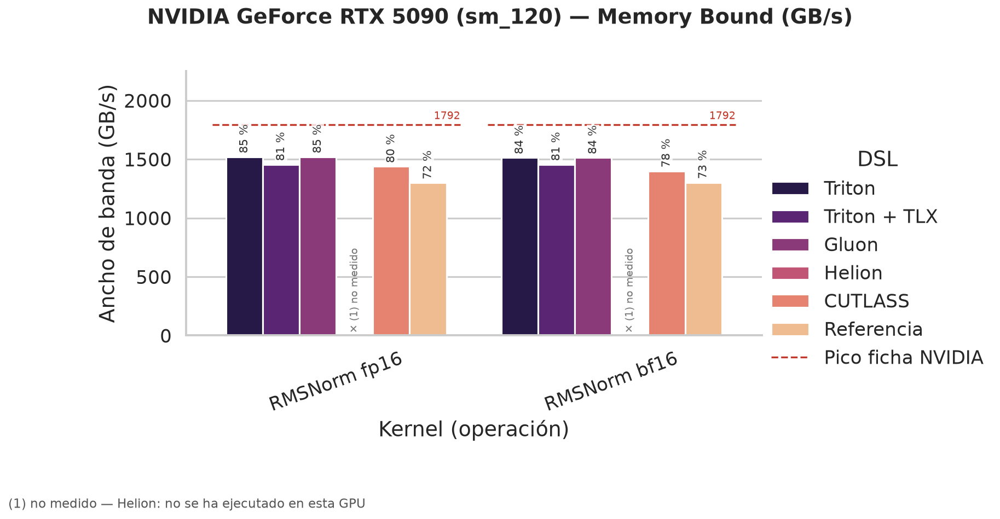

# Resumen: NVIDIA GeForce RTX 5090 (sm_120)

*Generado por `benchmarks/resumen.py` a partir de la última ejecución de cada benchmark en cada entorno. CB = compute-bound (TFLOP/s); MB = memory-bound (GB/s y % del pico de memoria). Cada celda: rendimiento en el mayor tamaño medido · % del pico · tamaño · configuración aplicada · entorno y job. Una celda sin dato dice por qué falta.*

*% del pico: en compute-bound, sobre el pico de `mma.sync` medido en esa GPU con `run_pico_mma` (acumulación FP32; en GB10, 122.7 TFLOP/s fp16 y 243.3 FP8, en ráfaga a ~2.5 GHz) o, si no se ha medido, sobre la ficha de NVIDIA (RTX 5090: 209.5 fp16 y 419 FP8 con acumulación FP32, al boost de 2 407 MHz). Por encima del 100 % de la ficha, la GPU va más rápida que el boost o no aplica el recorte de la acumulación FP32 (pendiente: `run_pico_mma` en pascal). En memory-bound, sobre el ancho de banda de la ficha. n/a = la variante no existe para ese algoritmo.*

| DSL | Matmul fp16 (CB) | Matmul FP8 (CB) | FlashAttention fp16 (CB) | FlashAttention causal fp16 (CB) | RMSNorm fp16 (MB) | RMSNorm bf16 (MB) |
|:---|:---|:---|:---|:---|:---|:---|
| **Triton** | **217.89 TFLOP/s** · **104 %** del pico ficha NVIDIA 8192×8192×8192 · BM=256 BN=128 BK=64 GROUP_M=8 · 8 warps (256 hilos) · 3 etapas _pascal, job 20499_ | **394.76 TFLOP/s** · **94 %** del pico ficha NVIDIA 8192×8192×8192 · BM=128 BN=256 BK=128 GROUP_M=8 · 8 warps (256 hilos) · 3 etapas · error 3.75% _pascal, job 20499_ | **162.82 TFLOP/s** · **78 %** del pico ficha NVIDIA B=4 H=32 N=16384 D=128 · BM=128 · BN=32 · 2 etapas · 4 warps (128 hilos) _pascal, job 20648_ | **157.2 TFLOP/s** · **75 %** del pico ficha NVIDIA B=4 H=32 N=16384 D=128 · BM=128 · BN=32 · 2 etapas · 4 warps (128 hilos) _pascal, job 20648_ | **1521.4 GB/s** · **85 %** del pico de memoria 16384×8192 · 16 warps (512 hilos) _pascal, job 20499_ | **1513.4 GB/s** · **84 %** del pico de memoria 16384×8192 · 16 warps (512 hilos) _pascal, job 20499_ |
| **Triton (block-ptr)** | **217.6 TFLOP/s** · **104 %** del pico ficha NVIDIA 8192×8192×8192 · BM=128 BN=128 BK=64 GROUP_M=8 · 4 warps (128 hilos) · 2 etapas · carga=cp.async _pascal, job 20499_ | n/a | n/a | n/a | n/a | n/a |
| **Triton + TMA** | **223.6 TFLOP/s** · **107 %** del pico ficha NVIDIA 8192×8192×8192 · BM=128 BN=128 BK=64 GROUP_M=8 · 4 warps (128 hilos) · 2 etapas · carga=TMA _pascal, job 20499_ | **394.47 TFLOP/s** · **94 %** del pico ficha NVIDIA 8192×8192×8192 · BM=256 BN=128 BK=128 GROUP_M=8 · 8 warps (256 hilos) · 3 etapas · carga=TMA · error 3.75% _pascal, job 20499_ | n/a | n/a | n/a | n/a |
| **Triton + TLX** | — *sin kernel*: no hay matmul en TLX | — *sin kernel*: no hay matmul en TLX | — *no compila*: los tutoriales de TLX usan wgmma/tcgen05 (Hopper, Blackwell de servidor) | — *no compila*: los tutoriales de TLX usan wgmma/tcgen05 (Hopper, Blackwell de servidor) | **1456.4 GB/s** · **81 %** del pico de memoria 16384×8192 · 3 etapas · 16 warps (512 hilos) · grid=340 (persistente) · carga=cp.async _pascal, job 20499_ | **1456.4 GB/s** · **81 %** del pico de memoria 16384×8192 · 3 etapas · 16 warps (512 hilos) · grid=340 (persistente) · carga=cp.async _pascal, job 20499_ |
| **Gluon** | — *no medido*: no se ha ejecutado en esta GPU | — *sin kernel*: no hay matmul FP8 en este DSL | — *no compila*: el ejemplo oficial usa tcgen05: LLVM ERROR Cannot select tcgen05.wait.st | — *no compila*: el ejemplo oficial usa tcgen05: LLVM ERROR Cannot select tcgen05.wait.st | **1521.2 GB/s** · **85 %** del pico de memoria 16384×8192 · 16 warps (512 hilos) · 8 elem/hilo (16 B) _pascal, job 20499_ | **1513.4 GB/s** · **84 %** del pico de memoria 16384×8192 · 16 warps (512 hilos) · 8 elem/hilo (16 B) _pascal, job 20499_ |
| **Helion** | — *no medido*: no se ha ejecutado en esta GPU | — *sin kernel*: no hay matmul FP8 en este DSL | **149.88 TFLOP/s** · **72 %** del pico ficha NVIDIA B=4 H=32 N=16384 D=128 · 1 warps (32 hilos) · bloques=[1,32,32] · 1 etapas · autotune=quick _pascal, job 20648_ | **75.85 TFLOP/s** · **36 %** del pico ficha NVIDIA B=4 H=32 N=16384 D=128 · 1 warps (32 hilos) · bloques=[1,32,16] · 1 etapas · autotune=quick _pascal, job 20648_ | — *no medido*: no se ha ejecutado en esta GPU | — *no medido*: no se ha ejecutado en esta GPU |
| **CUTLASS** | **165.83 TFLOP/s** · **79 %** del pico ficha NVIDIA 8192×8192×8192 · CuTe DSL Sm120GemmKernel · tile 128x128x64 _pascal, job 20638_ | — *sin kernel*: el dense_gemm de CuTe solo admite fp16/bf16 (su FP8 en GeForce es MXFP8) | **164.64 TFLOP/s** · **79 %** del pico ficha NVIDIA B=4 H=32 N=16384 D=128 · CuTe DSL FlashAttentionForwardAmpere · BM=128 BN=128 · 256 hilos (8 warps) _pascal, job 20648_ | **162.18 TFLOP/s** · **77 %** del pico ficha NVIDIA B=4 H=32 N=16384 D=128 · CuTe DSL FlashAttentionForwardAmpere · BM=64 BN=64 · 128 hilos (4 warps) _pascal, job 20648_ | **1438.7 GB/s** · **80 %** del pico de memoria 16384×8192 · cutlass::rmsnorm _e8 (float4) · 1024 hilos/bloque · 1 bloque/fila _pascal, job 20638_ | **1400.1 GB/s** · **78 %** del pico de memoria 16384×8192 · cutlass::rmsnorm _e1 (escalar) · 256 hilos/bloque · 1 bloque/fila _pascal, job 20638_ |
| **Referencia** | **209.14 TFLOP/s** · **100 %** del pico ficha NVIDIA 8192×8192×8192 · cuBLAS cutlass_80_tensorop_f16_s16816gemm_relu_f16_128x64_64x3_nn_align8 _pascal, job 20499_ | **598.67 TFLOP/s** · **143 %** del pico ficha NVIDIA 8192×8192×8192 · cuBLASLt (torch._scaled_mm) · error 3.75% _pascal, job 20499_ | **152.93 TFLOP/s** · **73 %** del pico ficha NVIDIA B=4 H=32 N=16384 D=128 · PyTorch SDPA pytorch_flash::flash_fwd_kernel _pascal, job 20648_ | **152.36 TFLOP/s** · **73 %** del pico ficha NVIDIA B=4 H=32 N=16384 D=128 · PyTorch SDPA pytorch_flash::flash_fwd_kernel _pascal, job 20648_ | **1299.3 GB/s** · **72 %** del pico de memoria 16384×8192 · PyTorch F.rms_norm _pascal, job 20638_ | **1302.8 GB/s** · **73 %** del pico de memoria 16384×8192 · PyTorch F.rms_norm _pascal, job 20638_ |

